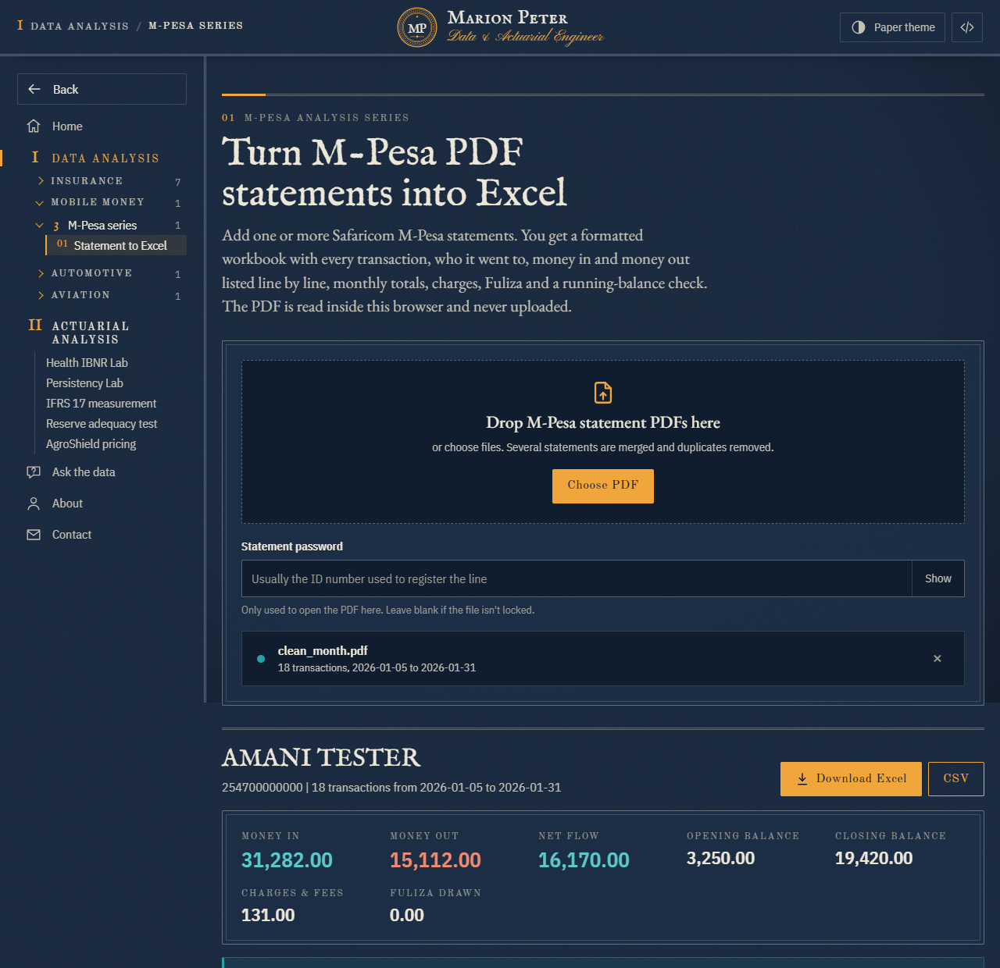

# mpesa-statement-to-excel

Turn Safaricom M-Pesa PDF statements into a checked Excel workbook, inside your own browser. Nothing is uploaded.

**Open it:** https://maidenpeter.github.io/mpesa-statement-to-excel/

Drop in one or more statements. The page lists every transaction with its type and counterparty, checks that every balance follows from the one before, compares its totals with the statement's own summary, and gives you a formatted workbook or a CSV.



*A synthetic statement made by the tests. The name and every number in it are invented.*

## What you get

- **Every transaction**, oldest first: completion time, receipt number, details, status, paid in, withdrawn and balance.
- **A type for each row**, read from the details: send money, received money, paybill, buy goods, agent withdrawal and deposit, airtime and bundles, transaction charges, Fuliza drawn, Fuliza repaid and Fuliza fees, M-Shwari, business payments in, reversals and a few more. Anything it does not recognise is kept as "Other money in" or "Other money out".
- **The counterparty**: the name, the phone, till or paybill number, and the account number for paybill payments.
- **Several statements at once.** Rows that appear in more than one statement (same receipt, time, details, amounts and balance) are kept once, so overlapping downloads can be combined.
- **The workbook** has six sheets:
  - Summary: the account, the period, the key figures and a table by type, all as live formulas, and the data checks;
  - Transactions: every row, filterable, with a balance check column and a totals row;
  - Money in and Money out: every transaction in that direction with its details (time, receipt, details, type, counterparty, number, account, amount, balance after and balance check), so each side can be checked line by line. The total follows any filter, and a formula under it checks the sheet against the Summary's money in or money out;
  - Monthly: money in and out, charges, Fuliza drawn and the closing balance for each month;
  - Counterparties: who money went to and came from.
- **On the page**, the transaction list can be narrowed to money in or money out, by type, or by a search, and it shows the money in and out of whatever is listed.
- **A CSV** of the transactions, marked as UTF-8 so Excel reads it correctly.

## Private by design

The statement is read with [PDF.js](https://github.com/mozilla/pdf.js) inside the page. It is never sent anywhere, and nothing is kept after you close the tab.

The page enforces this, and the tests check it:

- **A content security policy** in the page lets it load only its own files and connect only to its own origin. A script on the page cannot reach any other server.
- **The page loads nothing from anywhere else**: no fonts, analytics or code from a CDN. PDF.js and ExcelJS are copied into `lib/`.
- **The end-to-end test records every request** the page makes while it reads each synthetic statement and builds each workbook. It fails if any request goes to another origin, or if the policy blocks anything. It also checks that the policy stops a request to another site.

GitHub serves the page and its files, as for any website. After that, your statement stays in your browser.

**The password** opens the PDF in memory and is used for nothing else. It is never stored, logged, put in the address bar or written to the workbook. The test opens the locked statement, then searches the workbook, the CSV, the address bar, cookies, browser storage, the console and the page for the password. It fails if the password turns up in any of them.

## How it checks itself

- **Running balance.** Every row's balance must equal the previous balance plus money in minus money out. Rows that do not follow are highlighted on the page and flagged in the workbook's Balance check column, with the balance they should have had. A missing page, or a gap between two statements, shows up here.
- **The statement's own totals.** For a single statement, total money in and money out are compared with the TOTAL line of the statement's summary table.
- **Direction from the balance.** If an amount sits where its column is unclear, the change in balance decides whether it was money in or out. Any row decided this way is counted and reported.
- **Order within the same second.** A payment and its charge often carry the same completion time and can be printed in either order. Rows in the same second are put in the order their balances follow.
- **Rows split across pages.** When a transaction's details run over a page break, the two parts are joined back into one row.

## Which statements it reads

M-Pesa customer statements, downloaded as a PDF from the M-Pesa app or through *334#. They are usually locked with the ID number used to register the line.

Scanned or photographed statements have no text layer and cannot be read; the page says so instead of guessing.

## Known limits

- The parser reads the statement's layout: the column headings (Receipt No., Completion Time, Details, Transaction Status, Paid In, Withdrawn, Balance) and where each value sits on the page. If Safaricom changes that layout, the parser will need an update. The balance check makes a misread visible rather than silent.
- The types come from the wording of the Details column. New transaction descriptions fall into "Other money in" or "Other money out" until a rule is added in `lib/parser.js`.
- The tests run on synthetic statements, which copy the structure of a real statement but cannot cover every variation.

## Run it locally

PDF.js needs the page served over HTTP, not opened as a file:

```
python -m http.server 8000
```

Then open http://localhost:8000.

## Tests

`tests/make_fixtures.py` writes the synthetic statements in `tests/fixtures/synthetic/`, using only the Python standard library. Every name, phone number, till, account, receipt and password in them is invented. It also writes `expected.json`: every row and total each statement should give, worked out from the transactions it generated, not from the parser.

| Statement | What it tests |
|---|---|
| `clean_month.pdf` | One month on one page, with charges and paybill accounts |
| `multi_page.pdf` | Three pages; the column header repeated on each page; a row whose details run onto the next page; payments and their charges printed out of order |
| `overlap_a.pdf`, `overlap_b.pdf` | Two statements that both cover 10 to 20 April, to test merging and de-duplication |
| `fuliza.pdf` | Fuliza drawn, repaid and its fees, with the cells laid out centred on the row |
| `balance_break.pdf` | One payment missing from the rows but counted in the summary's TOTAL |
| `locked.pdf` | Password-protected (the password, `TEST1234`, is in `expected.json`) |
| `scanned.pdf` | An image with no text layer |

The tests:

```
python tests/check_text.py            # plain ASCII, no flagged phrases (the vendored builds are left out)
python tests/make_fixtures.py --check # the committed statements match a fresh build
node --test tests/parser.test.mjs     # PDF.js and the parser on every statement, row by row
pip install playwright openpyxl && python -m playwright install chromium
python tests/e2e.py                   # the page in a browser, end to end
```

- **The Node tests** read each statement with the same PDF.js build the page ships. They compare every row and every total with `expected.json`: receipt, time, details, amounts, balance, type, counterparty, account and balance check. They also test merging, the wrong-password and no-text-layer errors, the CSV and the vendored files' hashes.
- **The browser test** uploads each statement and reads the figures and checks the page shows. It downloads the workbook and the CSV, opens them, and compares their sheets, rows and totals with the expected values.
- **Privacy and layout.** The browser test also runs the request, policy and password checks described above, and confirms the page has no sideways scrolling at 1280 and 390 pixels wide.

GitHub Actions runs all of them on every push.

To try the page on a real statement of your own, put it in `tests/private/`. That folder is ignored by git, as are all PDFs, workbooks and CSVs outside the synthetic fixtures.

## Third-party code

PDF.js 3.11.174 (Apache-2.0) and ExcelJS 4.4.0 (MIT) are kept in `lib/` byte for byte as published. Their versions, licenses and SHA-256 hashes are in [THIRD_PARTY_NOTICES.md](THIRD_PARTY_NOTICES.md), and the license texts are in `LICENSES/`.
